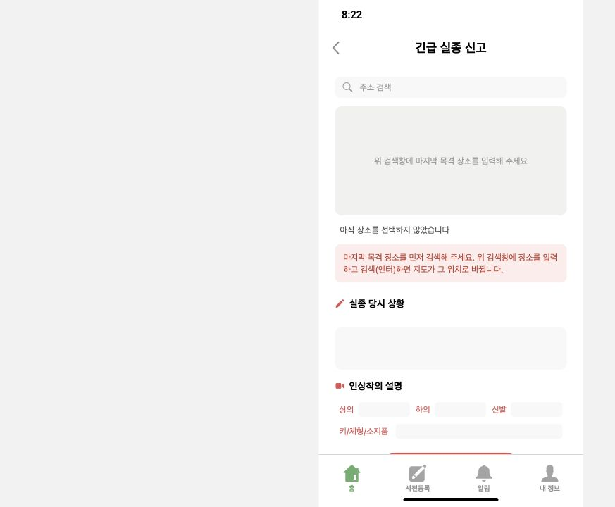

# 여의도 배포 E2E 점검 (2026-10-26)

현재 판정: **예측·저장 지도 경로 통과, 휴대폰 OS 푸시 확인 대기. 전체 E2E 완료 판정 아님.**

## 수정과 실제 서비스 결과

- 신고 화면의 고정 높이 때문에 잘리던 오류 문구와 시각 입력란의 큰 여백 수정. [PR #307](https://github.com/Donghaeng-AI-ROOKIE/Come-back-home/pull/307), 웹 배포 완료.
- 기존 망원 번들은 여의도 신고의 전체 조회 범위를 포함하지 못해 동적 로딩으로 넘어갔고, OSMnx의 상대 HTTP 캐시 `cache/`가 읽기 전용 컨테이너에서 쓰기 오류를 냈음. 데이터 볼륨의 HTTP 캐시로 수정. [PR #308](https://github.com/Donghaeng-AI-ROOKIE/Come-back-home/pull/308), 워커 배포 완료.
- 기존 대한민국 OSM 원본으로 여의도 7km 보행 도로망 생성. Supabase 비공개 `road-network-cache` 저장, 왕복 해시·최신 인덱스 검증 후 서버 캐시에 반영.
- 실제 앱에서 합성 등록 가족을 선택해 신고 E(`31840f744505`) 접수. 완료 화면이 자동으로 예측을 요청했고, 홈으로 이동한 뒤에도 서버 계산이 완료됨. 별도의 수동 predict 호출로 이 신고를 시작하지 않았음.

| 실제 신고 E 확인 항목 | 결과 |
| --- | --- |
| 축 채점 | OFF |
| SAR 초기 수치 | EXAONE 실제 호출, 수치 스냅샷 source=exaone |
| K 개인화 | 저장된 해석 applied / prepared_person |
| 마음 규칙 | 1개 컴파일, 500명 보행의 규칙 실행 시간 합계 약 4,136.67분 |
| 보행 중 모델 호출 | 0 |
| 도로망 | Supabase 사전 저장 여의도 지도 사용, 폴백 사유 없음 |
| 개인화·통계 | 0.3 / 문헌 이동거리 분포 0.7, 채널 TV 약 0.593으로 서로 다름 |
| 연속 보행 | continuous clock / checkpoint committed |
| 누락 확률 | 0 |
| 확률지도 | 387셀, 확률 합 1.0 |
| 알림 구역 | res9 80셀, 5.7901117km² ≤ 5.8km² |
| 예측 푸시 | 검사 시 발송 0건 |

규칙 실행 시간은 500명 가상 보행의 누적 합계이며 실제 사람의 보행 시간 측정값이 아니다. 상세 수치는 [service-result.json](service-result.json), 지도 출처·해시는 [road-manifest.json](road-manifest.json)에 보존했다.

## 격리 검증과 한계

종료된 첫 시험 사건 D는 실제 서비스에서 다시 열지 않았다. 별도 replay 식별자의 비영속 사본으로 당시 조건을 재생하여 저장 지도·연속 보행·확률 합을 확인했다. 이 재생은 약 27.148초였으며, 모델 결과를 재사용한 격리 재생 시간이다. 신규 실제 신고의 전체 응답 시간으로 쓰지 않는다.

합성 목격 제보 1건은 격리 사본에서 접수 후 layer2 재예측 및 지도 변경을 확인했다(확률 합 1.0, 도로망 사용, 누락 확률 0). 다만 접수 단계에 약 120.101초가 걸렸다. 이 지연은 해결 완료로 표시하지 않으며, 실제 시민 폰에서 제보 완료를 확인한 시험과 구분한다.

기존 제보 구조화 클라이언트가 사용량 원장을 거치지 않는 경로도 확인했다. 해당 호출 1건은 사후 수동 조정으로 기록했으며 정확한 HTTP 결과·토큰은 미확인이다. 관측 시간대에 다른 사용자 활동도 있었으므로 공유 원장의 모든 호출을 이 시험에 귀속하지 않는다. 금액·지원 차수 미확인은 null로 유지했다.

## 휴대폰 검증 상태

- 새 신고 E의 계산·지도는 확인했지만 현재 해당 신고 계정의 등록 푸시 구독이 0개다.
- 기존 기기에 보내기 전 조건 검사에서 중단되어, 추가 승인된 푸시 1회는 아직 발송하지 않았다.
- 서버 기기 위치는 아직 변경하지 않았다. 향후 임시 변경 검증은 실제 GPS 이동 시험과 구분한다.
- Mac이 잠겨 있어 미러링을 사용할 수 없음. 사용자의 잠금 해제·동일 계정 앱 알림 등록 확인 대기.
- 시험용 수신 제한은 지정 합성 프로필에만 적용한다. 지정 기기 해시가 없거나 일치하지 않으면 발송하지 않는다. 일반 프로필은 영향받지 않는다. 빈 설정이 기본이며, 시험 설정은 운영자의 보호된 설정에만 둔다.

## 전국 사전 구축 방향

현재 배포는 KINTEX·망원·여의도 등 일부 사전 구축 지도만 지원한다. 전국 사전 생성이 완료된 상태는 아니다.

기존 대한민국 OSM 원본에서 지역별 보행 도로망을 미리 만들고, 겹치는 범위의 조각·출처·버전·해시·공간 인덱스를 Supabase Storage에 저장하는 방식으로 확장할 수 있다. 신고 시 계산 반경 전체를 덮는 조각과 인접 조각을 함께 선택하고 OSM 노드 식별자로 연결해야 경계가 끊기지 않는다. 전국 파일을 매번 통째로 읽는 방식은 피하고, 사용한 조각은 서버 디스크·메모리에 재사용한다.

섬과 단절된 도로를 전국 최대 연결 성분만으로 제거하지 않아야 하며, 검증 대상은 시작점의 실제 접근 가능 도로·전체 계산 범위·경계 확률 손실이다. 버전 인덱스도 Storage 업로드와 서버 반영이 일치해야 한다. 전국 전처리 시간·저장 용량·전송량·비용은 아직 실측 전이다. 이번 승인에는 전국 생성 실행이 포함되지 않는다.

도로망 저장은 실제 소음·혼잡·수변 거리 레이어의 확보를 뜻하지 않는다. 이 합성 프로필의 마음 규칙은 1개이며 17개 기록은 실행 규칙 밖에 남는다. 임상 정확도·실제 실종 적중률을 검증한 자료가 아니다.
